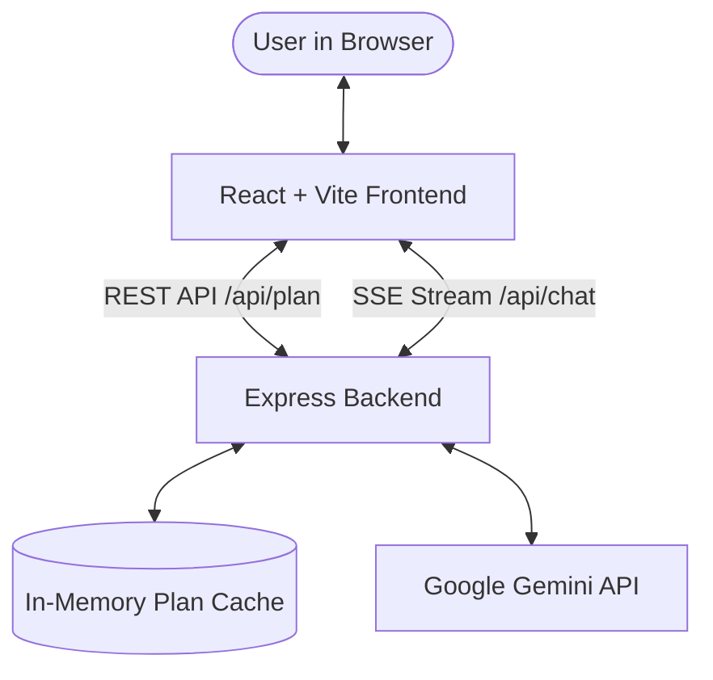

# ✈️ Wanderly – AI Travel Assistant

An intelligent, full-stack travel planner and real-time AI companion built with **React (Vite)**, **Node.js (Express)**, and **Google Gemini AI**. Wanderly generates personalized, day-by-day travel itineraries with realistic budgets in INR and features an interactive, streaming AI travel guide.

---

## 🌟 Key Features

- **🎯 Smart Itinerary Generator**:
  - Custom plans based on destination, duration (1–14 days), budget (INR), group size, and travel mood (*Adventure, Chill, Spiritual, Foodie, Romantic, Backpacker*).
  - Returns structured, day-wise timeline with time slots (Morning, Afternoon, Evening), activity descriptions, and cost estimates.
  - Category-wise expense breakdown: *Stay, Food, Transport, and Activities*.
  - Curated packing checklist and essential local tips.

- **💬 Real-Time Streaming Travel Chatbot**:
  - Interactive chat powered by Gemini via **Server-Sent Events (SSE)** for fast, token-by-token streaming.
  - **Context-Aware**: Receives your active itinerary so you can ask specific questions like *"Where can I find budget vegetarian food on Day 2?"*.
  - Focused travel guardrails with multilingual support (English & Hinglish).

- **⚡ Resilient & Fast Backend Architecture**:
  - **Auto-Discovery & Fallback**: Automatically discovers and tests active Gemini models (e.g., `gemini-3.8-flash`), handles HTTP 429 quota exhaustion with automatic cooldown, and gracefully switches models.
  - **In-Memory Caching**: Caches generated itineraries for identical search parameters to reduce latency and conserve API quota.
  - **Rate Limiting**: Built-in IP rate limiter (20 requests/min) to prevent abuse.

---

## 🏗️ Architecture & How It Works



1. **User Request**: The user selects a destination, budget, mood, and travel duration on the React frontend.
2. **Backend Processing**: Express checks the in-memory cache. If cached, it returns the itinerary instantly.
3. **AI Generation**: If not cached, it calls the Gemini API using structured JSON output mode. If rate limits occur, the backend model fallback mechanism switches to alternate Flash models.
4. **Interactive Chat**: When chatting, user queries (along with trip context) are streamed back to the client using Server-Sent Events.

---

## 🛠️ Tech Stack

- **Frontend**:
  - [React 18](https://react.dev/) + [Vite](https://vitejs.dev/)
  - [Framer Motion](https://www.framer.com/motion/) (Smooth animations)
  - [Lucide React](https://lucide.dev/) (Modern iconography)
  - Custom responsive CSS with glassmorphism styling
- **Backend**:
  - [Node.js](https://nodejs.org/) & [Express](https://expressjs.com/)
  - [@google/genai](https://www.npmjs.com/package/@google/genai) (Google Gemini SDK)
  - [dotenv](https://www.npmjs.com/package/dotenv) & [cors](https://www.npmjs.com/package/cors)
- **AI Model**:
  - Google Gemini 3.8 Flash (with automatic model discovery & failover)

---

## 📁 Project Structure

```
ai-travel-assistant/
├── package.json               # Root scripts to run both client and server
├── .gitignore                 # Git ignore rules for node_modules and .env
├── README.md                  # Project documentation
├── server/                    # Backend API
│   ├── index.js               # Express server, Gemini client, cache & fallbacks
│   ├── package.json           # Backend dependencies
│   ├── .env.example           # Environment template (safe for git)
│   └── .env                   # Local API keys (ignored by git)
└── client/                    # Frontend UI
    ├── index.html             # HTML entry point
    ├── vite.config.js         # Vite configuration with /api proxy
    ├── package.json           # Frontend dependencies
    └── src/
        ├── App.jsx            # Main view, form input, and featured destinations
        ├── index.css          # Design system & styles
        ├── main.jsx           # React root
        └── components/
            ├── ItineraryView.jsx # Day-by-day plan, budget breakdown, packing list
            └── ChatBot.jsx       # Floating streaming chat assistant
```

---

## 🚀 Getting Started

### 1. Prerequisites
- **Node.js** (v18.0 or higher): [Download Node.js](https://nodejs.org/)
- **Gemini API Key**: Obtain a free key from [Google AI Studio](https://aistudio.google.com/app/apikey).

### 2. Installation

Clone the repository and install dependencies:

```bash
# Clone the repository
git clone https://github.com/vanshgajera/Ai_Assistant_chatbot.git
cd Ai_Assistant_chatbot

# Install dependencies for both client and server
npm run install:all
```

*(Or install individually by running `npm install` inside both `client` and `server` directories).*

### 3. Environment Setup

Create an environment file in the `server` folder:

- **Windows**:
  ```powershell
  copy server\.env.example server\.env
  ```
- **macOS / Linux**:
  ```bash
  cp server/.env.example server/.env
  ```

Open `server/.env` and insert your Gemini API Key:
```env
GEMINI_API_KEY=your_actual_gemini_api_key_here
GEMINI_MODEL=gemini-3.8-flash
PORT=5000
```

> ⚠️ **Important**: Never commit or share your `.env` file publicly. It is already added to `.gitignore`.

### 4. Running the Application

Run both client and server concurrently with a single command from the project root:

```bash
npm run dev
```

- **Frontend Client**: [http://localhost:5173](http://localhost:5173)
- **Backend API Server**: [http://localhost:5000](http://localhost:5000)

---

## 📡 API Endpoints

| Method | Endpoint | Description |
|---|---|---|
| `GET` | `/` | Health check route |
| `GET` | `/api/health` | Inspect active model chain, cooldowns, and cache status |
| `POST` | `/api/plan` | Generates a structured JSON itinerary for a given destination, days, budget, mood, and travelers |
| `POST` | `/api/chat` | Server-Sent Events (SSE) streaming chat endpoint with trip context |

---

## 🛡️ License

This project is licensed under the [MIT License](LICENSE).
